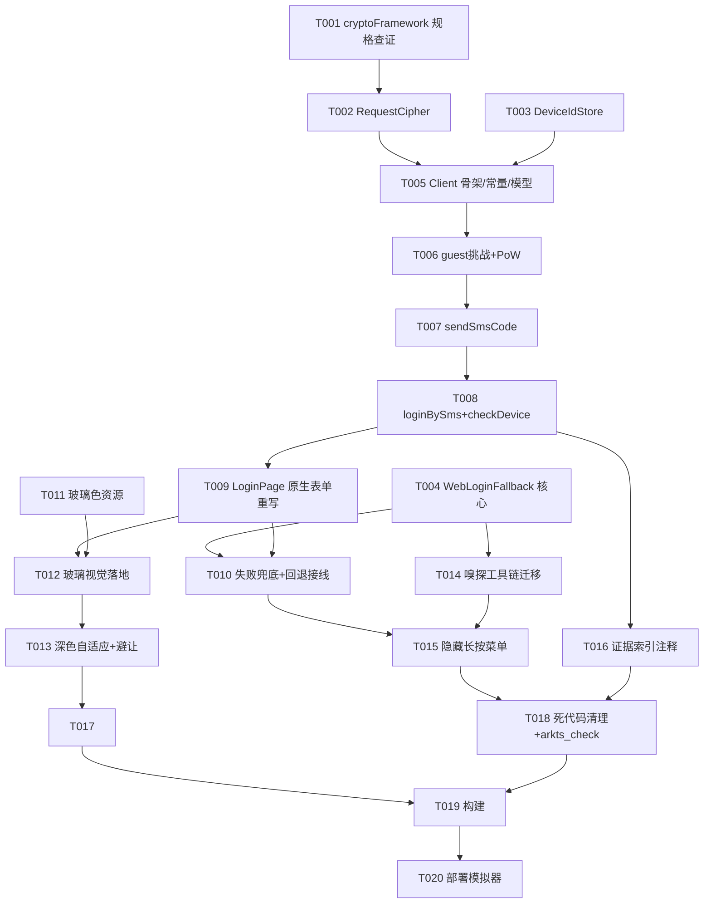

# Tasks: 登录页液态玻璃全原生重构（login-glass）

**Input**: Design documents from `spec/login-glass/`（spec.md、plan.md、evidence/api-analysis.md）
**Prerequisites**: plan.md (required), spec.md (required for user stories)

**Tests**: 无独立测试任务（项目无测试框架；以 arkts_check + 构建 + 模拟器手动验证为准，见 Verification 阶段）。

**Organization**: 按 User Story 分组（US1 原生登录 P1 / US2 玻璃视觉 P1 / US3 证据+隐藏调试 P2），每个故事可独立实现与验证。

## Format: `[ID] [P?] [Story] Description`

- **[P]**: 可并行（不同文件、无未完成依赖）
- **[Story]**: 归属用户故事（US1/US2/US3）
- 所有描述含精确文件路径

## Path Conventions

- 源码根：`entry/src/main/ets/`（service/ components/ pages/ 分层）
- 资源：`entry/src/main/resources/base/element/color.json`（+ dark 变体如存在）
- 证据（只读参考）：`spec/login-glass/evidence/api-analysis.md`
- 测试文档：`docs/TEST_REQUIREMENTS.md`

---

## Phase 1: Setup

**Purpose**: 消除实现期唯一技术风险点（RD-02 MGF1 规格串），确保加密实现一次写对。

- [X] T001 用 devecocli docs 查证 cryptoFramework RSA-OAEP 规格串格式（MGF1-SHA-256 显式指定方式，如 `RSA2048|PKCS1|OAEP|SHA256|MGF1_SHA256`）与 AES-CBC/PKCS7 用法（创建 Cipher、SymKey 导入、PKCS7 填充），记录确切 API 调用形式，供 T002 实现

---

## Phase 2: Foundational (Blocking Prerequisites)

**Purpose**: US1 依赖的两大基础设施（加密器、设备标识）。两者互不依赖，可并行。

- [X] T002 [P] 实现 `entry/src/main/ets/service/RequestCipher.ets`：`encryptRequest(plainJson: string): Promise<CipherRequest>`；内置生产公钥 SPKI base64 常量（取自 spec/login-glass/evidence/api-analysis.md §4）；流程 = 随机 16B AES-128 key + 16B IV → AES-CBC(PKCS7) 加密明文 → `key||IV`(32B) → RSA-2048-OAEP(SHA-256, MGF1-SHA-256) 加密 → base64 为 `encryptionKey`；定义 `CipherRequest{ body: Uint8Array, encryptionKey: string }` 模型；提供本地回环自验辅助方法（固定 key/IV 加密→解密回环比对，供开发期验证）
- [X] T003 [P] 实现 `entry/src/main/ets/service/DeviceIdStore.ets`：`getOrCreate(): Promise<string>`；首启用 util.generateRandomUUID 生成 UUID v4 存 Preferences（键 `auth_device_id`），之后直接返回缓存值

**Checkpoint**: 加密器与设备标识就绪，US1 可开工。

---

## Phase 3: User Story 1 - 原生手机号+短信验证码登录 (Priority: P1) 🎯 MVP

**Goal**: 用户在原生表单输入手机号、收码、登录成功进入聊天；底层直连 DeepSeek SMS API（挑战→PoW→加密→token）。

**Independent Test**: 模拟器部署后进入登录页，输入真实手机号→收到短信验证码→输入→登录成功返回聊天页且会话可用。

- [X] T004 [P] [US1] 创建 `entry/src/main/ets/components/WebLoginFallback.ets`：从现有 `entry/src/main/ets/pages/LoginPage.ets` 迁移 WebView 登录核心（加载 sign_in 页 + 桌面 UA、Cookie 轮询捕获 userToken、登录成功判定），组件入参 `onLoginSuccess: () => void`；此阶段仅完成组件本身，暂不接线
- [X] T005 [US1] 创建 `entry/src/main/ets/service/DeepSeekLoginClient.ets` 骨架：定义模型（`GuestChallengeInfo`、`SendSmsResult`、`LoginResult`）与 raw 响应接口（字段全可选、snake_case）；定义取证常量（LOGIN_BASE_URL、x-client-version 2.7.0、x-client-locale zh_CN、x-client-timezone-offset 28800、region `[unset]`、os `web`，见 evidence §1/§2）；实现 `buildBaseHeaders(deviceId)` 公共请求头组装（引用 DeviceIdStore）
- [X] T006 [US1] 在 `entry/src/main/ets/service/DeepSeekLoginClient.ets` 实现 guest 挑战流程：POST `/api/v0/users/create_guest_challenge`（明文 `{"target_path":"/sign_in"}`，按 evidence §1）→ 响应映射到 `GuestChallengeInfo` → 复用现有 `PowSolver`/`DeepSeekHash` 求解（taskpool，n < difficulty）→ 构造 `x-ds-guest-pow-response: base64({"salt":"<挑战salt>","answer":<n>})` 请求头
- [X] T007 [US1] 在 `entry/src/main/ets/service/DeepSeekLoginClient.ets` 实现 `sendSmsCode(mobile: string): Promise<SendSmsResult>`：经 RequestCipher 加密请求体 `{locale:"zh_CN", turnstile_token:"", shumei_verification:"", hcaptcha_token:"", device_id, scenario:"login", mobile_number}` → 携带 PoW 头与 `x-request-encryption-key` 头 POST `/api/v0/users/create_sms_verification_code` → 映射响应 `send_window_secs`（缺失兜底 60）
- [X] T008 [US1] 在 `entry/src/main/ets/service/DeepSeekLoginClient.ets` 实现 `loginBySms(mobile, smsCode): Promise<LoginResult>` 与 `checkDevice(token): Promise<boolean>`：登录体 `{locale:"zh_CN", region:"[unset]", mobile_number, area_code:"+86", sms_verification_code, device_id, os:"web"}` 加密后 POST `/api/v0/users/login_by_mobile_sms` → 按 RD-05 判定（`data.biz_data.user.token` 非空即成功，biz_code=1 亦成功）→ checkDevice 尽力而为（明文 JSON + Bearer，失败静默）
- [X] T009 [US1] 重写 `entry/src/main/ets/pages/LoginPage.ets` 为全原生表单：手机号输入（+86 前缀、11 位校验）+ 验证码输入 + 发送验证码按钮（发送中禁用、倒计时取 `sendWindowSecs`/60 兜底）+ 登录按钮（loggingIn 加载态 + "安全校验中"文案，PoW 求解期间不阻塞 UI）；调用 DeepSeekLoginClient，成功后 `TokenStore.set(token)` → `pathStack.pop()`；**保持契约**：`Login` 路由名、`LoginBuilder` 导出、`NavDestination` 根节点、`onReady(pathStack)` 行为不变；使用 `@ComponentV2` + `@Local` 状态（phone/smsCode/countdown/sendingCode/loggingIn/statusText/statusError）
- [X] T010 [US1] 在 `entry/src/main/ets/pages/LoginPage.ets` 实现失败兜底链路（RD-08）：任一环节失败→内联错误提示（服务端 `biz_msg`/`msg` 优先，映射不到用兜底文案）+ "遇到问题？使用网页登录"引导链接 → 全屏弹层打开 `WebLoginFallback`，其 `onLoginSuccess` 走同一 finishLogin 路径（TokenStore.set → pop）

**Checkpoint**: US1 完成——原生登录全链路可用，WebView 回退可达，登录永不中断。

---

## Phase 4: User Story 2 - 液态玻璃视觉 (Priority: P1)

**Goal**: 登录页呈现与全应用一致的液态玻璃质感（光斑背景、玻璃卡片、玻璃按钮），深浅色自适应。

**Independent Test**: 浅色/深色模式截图检查：玻璃卡片有折射感与高光描边、按钮为品牌蓝胶囊、无布局破版；键盘弹出时表单完整可见。

- [X] T011 [P] [US2] 在 `entry/src/main/resources/base/element/color.json`（及 dark 变体目录如存在）补充玻璃视觉色资源：玻璃卡片表面色（rgba 白 0.5-0.6 系）、氛围光斑色（品牌蓝低透明度）、高光描边色、辅助文案色，全部以 `glass_*` 前缀命名并配 dark 值
- [X] T012 [US2] 在 `entry/src/main/ets/pages/LoginPage.ets` 落地 RD-07 液态玻璃视觉：`chat_bg` 底 + 左上/右下两团低透明度品牌蓝径向渐变氛围光斑；居中表单卡片 `backgroundEffect`(radius≈30, saturation 1.4-1.6, brightness 1.1-1.2, color rgba(255,255,255,0.5-0.6), adaptiveColor DEFAULT) + 1px rgba(255,255,255,0.9) 高光描边 + 柔和投影（rgba(38,38,38,0.10), offsetY 2-6）；登录按钮为品牌蓝 `#4D6BFE` 胶囊大按钮（加载态内嵌小型 Loading）；发送验证码为玻璃次级按钮（倒计时禁用态"<n>s 后重发"）
- [X] T013 [US2] 在 `entry/src/main/ets/pages/LoginPage.ets` 完成自适应与避让：颜色全部走 `$r('app.color.*')` 资源 + adaptiveColor 自动适配深色模式；键盘弹出时表单上移不被遮挡（expandSafeArea/避让处理）；顶部状态栏安全区避让；错误态文案使用 `danger` 色

**Checkpoint**: US2 完成——视觉达标且深浅色均正常。

---

## Phase 5: User Story 3 - API 证据固化 + 隐藏调试入口 (Priority: P2)

**Goal**: 调试工具（WebView 嗅探、API 记录）保留但隐藏；证据文件与代码契约互相引用可追溯。

**Independent Test**: 默认界面无任何调试痕迹；长按标题 ≥1s 弹出隐藏菜单，可进入网页登录/嗅探模式/API 记录；DeepSeekLoginClient 头部注释可索引到 evidence 文件。

- [X] T014 [US3] 扩展 `entry/src/main/ets/components/WebLoginFallback.ets`：从旧 LoginPage 迁移嗅探工具链（SNIFFER_JS 注入、`[SNIFF]` 日志捕获、嗅探模式开关、API 记录面板），全部内聚在组件内
- [X] T015 [US3] 在 `entry/src/main/ets/pages/LoginPage.ets` 实现隐藏入口（RD-06）：长按页面标题/Logo 区域 ≥1s 弹出隐藏菜单（"使用网页登录（备用）"/"嗅探模式"/"API 记录"）→ 以对应模式全屏弹层打开 WebLoginFallback；默认界面零调试痕迹
- [X] T016 [US3] 在 `entry/src/main/ets/service/DeepSeekLoginClient.ets` 文件头部添加端点契约索引注释（各端点/请求头/加密方案 → `spec/login-glass/evidence/api-analysis.md` 对应章节引用）；核验 `spec/login-glass/evidence/` 三份证据文件完整在库

**Checkpoint**: US3 完成——调试能力保留且隐藏，证据可追溯。

---

## Phase 6: Polish & Cross-Cutting Concerns

**Purpose**: 文档收尾与死代码清理。

- [X] T017 [P] 更新 `docs/TEST_REQUIREMENTS.md`：追加 login-glass 测试需求（原生短信登录流程 F9/TC 系列：发码倒计时、登录加载态、错误提示、WebView 回退、隐藏入口长按、深色模式玻璃视觉、ChatPage 回归）
- [X] T018 清理死代码：确认旧 LoginPage 中 WebView/嗅探逻辑已全部迁移（grep 校验无孤儿引用：SNIFFER_JS/sniffToggle 等仅存在于 WebLoginFallback.ets）；对全部改动/新增 .ets 文件运行 arkts_check 并修复所有告警

---

## Phase 7: Verification

<!-- verification_scope: build-only -->

**Purpose**: 构建与部署验证（用户已选择 build-only 范围，不含 UI 验证任务）。

- [X] T019 构建项目并修复编译错误（执行 `devecocli build`；迭代 修复→构建 直至成功）→ ✅ PASS（首次构建即成功，BUILD SUCCESSFUL in 5s 566ms，5 个新文件零警告零错误）
- [X] T020 部署应用到模拟器（执行 `devecocli run --skip-build --device 127.0.0.1:5555`；若报 "install sign info inconsistent" 先用 hdc 卸载 `<bundleName>` 再重试）→ ✅ PASS（签名一致直接安装，启动成功，Smoke: PASS）

---

## Dependencies & Execution Order

### 任务依赖图

### Phase Dependencies

- **Setup (Phase 1)**: 无依赖，立即可开始
- **Foundational (Phase 2)**: T002 依赖 T001（规格查证）；T003 无前置 —— 两者完成后才可开始 US1
- **User Stories (Phase 3-5)**: 均依赖 Foundational 完成；US1 为 MVP 优先路径，US2/US3 在 US1 后按序推进
- **Polish (Phase 6)**: 依赖所有 User Story 完成
- **Verification (Phase 7)**: 依赖全部实现任务完成

### User Story Dependencies

- **US1 (P1)**: 依赖 T002/T003；T005→T006→T007→T008 同文件串行；T009→T010 串行；T004 与 service 层并行
- **US2 (P1)**: T011 色资源先行 → T012（依赖 T009 完成的重写页面）→ T013
- **US3 (P2)**: T014 依赖 T004；T015 依赖 T010+T014；T016 依赖 T008

### Within Each User Story

- 模型/常量先于服务方法（T005 先于 T006-T008）
- 服务层先于 UI 接线（T008 先于 T009）
- 核心实现先于交互完善（T009 先于 T010）

## Parallel Example

| Phase | Tasks | Required Files | Execution Notes |
| :--- | :--- | :--- | :--- |
| Foundational | T002 ∥ T003 | RequestCipher.ets ∥ DeviceIdStore.ets | 不同文件、互不依赖，可并行 |
| US1 | T004 ∥ (T002,T003) | WebLoginFallback.ets ∥ service 层 | T004 只依赖旧 LoginPage 源码，与 Foundational 并行 |
| US1 内部 | T005→T006→T007→T008 | DeepSeekLoginClient.ets | 同文件串行 |
| US2 | T011 ∥ (T009,T010) | color.json ∥ LoginPage.ets | 色资源可与 US1 收尾并行 |
| US3 | T014 ∥ (T011,T012) | WebLoginFallback.ets ∥ LoginPage.ets | 不同文件可并行 |
| Polish | T017 ∥ (T014,T015,T016) | TEST_REQUIREMENTS.md ∥ 源文件 | 文档任务随时可做 |

## Implementation Strategy

### MVP First (User Story 1 Only)

1. Complete Phase 1: Setup（T001 规格查证）
2. Complete Phase 2: Foundational（T002 加密器 + T003 设备标识）
3. Complete Phase 3: User Story 1（T004–T010 原生登录全链路）
4. **STOP and VALIDATE**: 模拟器验证原生短信登录可用 + WebView 回退可达
5. Deploy 可演示

### Incremental Delivery

1. Setup + Foundational → 加密与设备标识就绪
2. US1（T004–T010）→ 原生登录 + 回退（MVP！）
3. US2（T011–T013）→ 液态玻璃视觉
4. US3（T014–T016）→ 隐藏调试工具 + 证据索引
5. Polish（T017–T018）→ 测试文档 + 清理
6. Verification（T019–T020）→ 构建 + 部署

## Notes

- [P] 任务 = 不同文件且无未完成依赖
- [USx] 标签将任务映射到 spec.md 用户故事，保证可追溯
- 每个 User Story 的 Checkpoint 可独立验证后再进入下一故事
- 登录 PoW difficulty≈80000，taskpool 求解数百毫秒~数秒，UI 用加载态 + "安全校验中"覆盖
- 三 captcha token 固定空串（与取证一致：大陆手机号登录流程不触发人机验证）
- T019/T020 为 build-only 验证范围（用户 Phase 3 已选择 "Run verification"）；UI 手动验收可在部署后由用户自行进行
- 部署时若签名不一致需先 `hdc uninstall <bundleName>`（注意：卸载会清除应用数据，需重新登录）

## Summary Report

- **总任务数**: 20（T001–T020）
- **分故事统计**:
  - Setup: 1（T001）
  - Foundational: 2（T002–T003，均可并行）
  - US1 原生登录: 7（T004–T010）
  - US2 玻璃视觉: 3（T011–T013）
  - US3 证据+隐藏调试: 3（T014–T016）
  - Polish: 2（T017–T018）
  - Verification: 2（T019–T020，build-only）
- **并行机会**: T002/T003/T004 三路并行起步；T011 色资源与 US1 收尾并行；T017 文档并行
- **独立测试判据**: 每 Story 的 Checkpoint 均可独立验证（US1 真机短信登录全链路；US2 深浅色截图比对；US3 长按隐藏入口 + 证据索引）
- **建议 MVP 范围**: T001–T010（Setup + Foundational + US1）——完成即得到"可用的原生登录 + WebView 回退"，随后 T011–T013 补视觉，T014–T016 补调试工具
