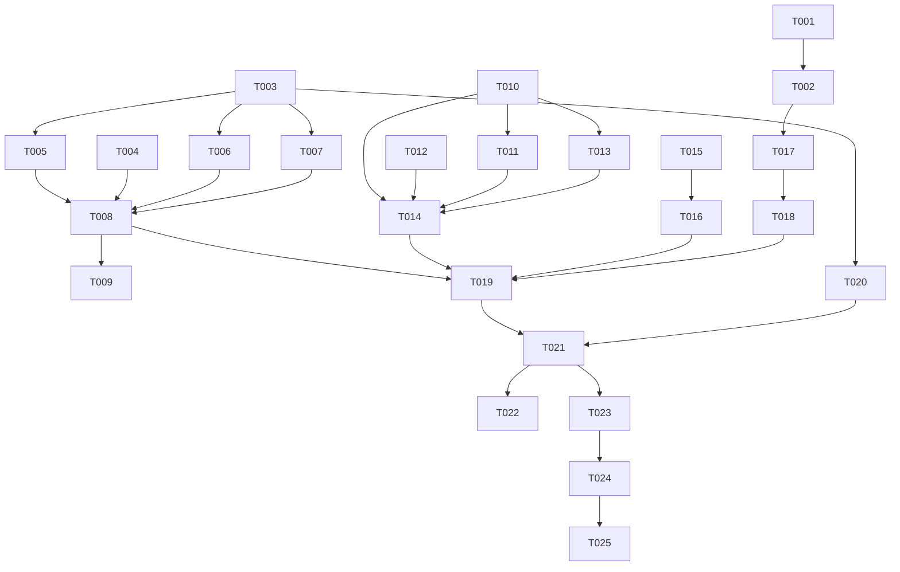

# Tasks: markdown-v2（Markdown 完整渲染引擎升级）

**Input**: Design documents from `spec/markdown-v2/`（spec.md、plan.md）
**Prerequisites**: plan.md (required), spec.md (required for user stories)

**Tests**: 未单独生成测试任务（验证集中在 Verification 阶段的构建+UI 验证，按 spec 约定）。

**Organization**: 任务按用户故事分组（US1-US5），每故事独立可测、可增量交付。

## Format: `[ID] [P?] [Story] Description`

- **[P]**: 可并行（不同文件、无未完成依赖）
- **[Story]**: 对应 spec.md 用户故事（US1-US5）
- 任务描述含具体文件路径

## Path Conventions

- 单项目结构：`entry/src/main/ets/`（源码）与 `entry/src/main/resources/`（资源）
- 所有路径相对 `{PROJECT_ROOT}` = `<工程根目录>`（即本仓库根目录）
- spec 工件位于 `spec/markdown-v2/`

---

## Phase 1: Setup（资源准备）

- [X] T001 获取 mermaid v10 UMD 离线包：通过 `npm pack mermaid@10` 下载 npm 包并提取 `package/dist/mermaid.min.js` 复制到 `entry/src/main/resources/rawfile/mermaid.min.js`，校验体积约 2.5MB（禁止 CDN 在线依赖）
- [X] T002 创建 `entry/src/main/resources/rawfile/mermaid_view.html`：相对引用同目录 `./mermaid.min.js`，`mermaid.initialize({ startOnLoad: false, theme: 'neutral', securityLevel: 'strict' })`，通过 javaScriptProxy 约定接口接收图表代码、回传渲染后 SVG 高度（px）、上报解析错误；白底页面样式与聊天页协调

---

## Phase 2: Foundational（阻塞性基础设施）

**⚠️ 本阶段完成前不得开始任何用户故事**

- [X] T003 扩展解析器数据模型：`entry/src/main/ets/components/MarkdownParser.ets` 中 MdBlockKind 新增 BlockFormula/FootnoteDef；MdBlock 新增 depth/taskState/codeClosed/quoteLevel/latexSource/footnoteId 字段；MdSpan 新增 strike/imageUrl/footnoteRef/latexSource 字段（保持既有构造兼容，全部显式类型）
- [X] T004 [P] 新增 `entry/src/main/ets/components/StyledText.ets`：@ComponentV2 通用富文本组件（@Param spans/fontSize/lineHeight、onLinkClick 回调），内部用 TextController 绑定 MutableStyledString；GestureStyle 回调对象提升为组件成员变量延长生命周期（faqs-arkui-901 要求）
- [X] T005 新增 `entry/src/main/ets/components/MdInlineBuilder.ets`：MdSpan[] → MutableStyledString 构建器（TextStyle/DecorationStyle 删除线/BaselineOffsetStyle 上下标/GestureStyle 链接点击/ImageAttachment 行内图片/脚注角标），本阶段不含 latexSource 处理（US2 扩展）；同步扩展 `entry/src/main/ets/components/MarkdownRenderer.ets` 的 blockSignature 覆盖全部新字段

**Checkpoint**: 基础设施就绪，各用户故事可开始

---

## Phase 3: User Story 1 - 标准 Markdown 全语法 (Priority: P1) 🎯 MVP

**Goal**: 嵌套列表/任务列表/删除线/图片/链接点击/脚注/引用增强/表格内格式/软换行全部正确渲染
**Independent Test**: 发送一条覆盖全部新语法的测试消息，截图核对无原文符号外露

- [X] T006 [US1] 解析器嵌套列表与任务列表：`entry/src/main/ets/components/MarkdownParser.ets` 列表缩进解析（Tab=4 空格、2/4 空格混合，depth 计算）与 `- [ ]`/`- [x]` taskState 识别
- [X] T007 [US1] 解析器行内与块语法补全：`entry/src/main/ets/components/MarkdownParser.ets` parseInline 扩展 `~~删除线~~`、`` 图片、`[^n]` 脚注引用；块级新增脚注定义行 `[^n]: text`、相邻多行引用合并+`>>` quoteLevel、段内软换行保留（join 改 '\n'）
- [X] T008 [US1] 渲染器新块渲染：`entry/src/main/ets/components/MarkdownRenderer.ets` ListItem 按 depth 缩进 padding、taskState 渲染复选框图标（SymbolGlyph 两态）、Quote 按 quoteLevel 嵌套样式、FootnoteDef 文末渲染、段落/标题/列表/引用/表格单元格的行内渲染全部改用 StyledText（依赖 T004/T005）
- [X] T009 [US1] 链接可点击预览：`entry/src/main/ets/components/MarkdownRenderer.ets` onLinkClick → 携带 url 参数跳转复用 `entry/src/main/ets/pages/WebFallbackPage.ets`（先核对该页面路由参数接口，按现状适配）

**Checkpoint**: US1 独立可测——标准语法消息渲染正确

---

## Phase 4: User Story 2 - LaTeX 原生公式渲染 (Priority: P1)

**Goal**: 行内 `$...$` 与块级 `$$...$$` 公式原生排版渲染，复杂结构降级，货币 `$` 防误判，流式安全
**Independent Test**: 发送数学推导类问题，核对分数/根号/上下标/求和积分排版

- [X] T010 [P] [US2] 新增 `entry/src/main/ets/components/LatexParser.ets`：LaTeX 源 → LatexNode 树解析器（Atom/Group/Sup/Sub/Frac/Sqrt/Limits/Styled/Degraded 节点、希腊字母与运算符 Unicode 映射表、未识别命令降级检测），导出 parseLatex 与 linearizeLatexInline，模块级 LRU 缓存（上限 64）
- [X] T011 [US2] 公式识别接入解析器：`entry/src/main/ets/components/MarkdownParser.ets` 块级 `$$` 检测（含 codeClosed 流式安全、未闭合按原文）、行内 `$` 配对识别（紧邻非空白+LaTeX 特征字符或短数学串防货币误判）、`\(` `\)` `\[` `\]` 定界符支持
- [X] T012 [P] [US2] 新增 `entry/src/main/ets/components/LatexRenderer.ets`：块级公式原生渲染组件（@Param source/degraded），分数 Column 上下结构、根号 Stack 覆盖线、上下标 baselineOffset、Limits 求和积分上下限、降级等宽浅蓝底原文样式
- [X] T013 [US2] 行内公式渲染接入：`entry/src/main/ets/components/MdInlineBuilder.ets` 扩展 latexSource span 处理——linearizeLatexInline 线性化为 StyledString 片段（上下标 BaselineOffsetStyle+缩小字号、分数线性化、符号 Unicode 映射）
- [X] T014 [US2] BlockFormula 分发：`entry/src/main/ets/components/MarkdownRenderer.ets` 新块类型接入 LatexRenderer（依赖 T010/T012）

**Checkpoint**: US1+US2 均独立可测——数学类消息公式排版正确

---

## Phase 5: User Story 3 - 代码语法高亮 (Priority: P2)

**Goal**: 10 语言四类 token 着色，未知语言降级，10KB<10ms
**Independent Test**: 发送代码类问题，核对关键字/字符串/注释/数字分色

- [X] T015 [P] [US3] 新增 `entry/src/main/ets/components/CodeHighlighter.ets`：10 语言（js/ts/python/java/c/cpp/json/bash/sql/html/css）规则表（关键字集合/行注释/块注释/字符串定界，html/css 专用结构规则）+ 单遍扫描 tokenizer + One Dark 配色映射 + 模块级 LRU 缓存（上限 64）
- [X] T016 [US3] 代码块高亮渲染：`entry/src/main/ets/components/MarkdownRenderer.ets` buildCodeBlock 接入 highlight()，token 用 Span 着色渲染，未知语言保持无色+复制按钮

**Checkpoint**: US3 独立可测——代码块正确着色

---

## Phase 6: User Story 4 - Mermaid 图表渲染 (Priority: P2)

**Goal**: mermaid 代码块渲染为图表，流式/语法错误降级，实例随消息销毁
**Independent Test**: 发送"画一个流程图（mermaid）"，核对图表渲染

- [X] T017 [P] [US4] 新增 `entry/src/main/ets/components/MermaidView.ets`：@ComponentV2 Web 封装（@Param code/closed），Code/Chart/Fallback 状态机，$rawfile('mermaid_view.html') 加载，registerJavaScriptProxy 传码/回传高度/错误回调，高度自适应+上限封顶+超宽内滚，onDisAppear/组件销毁释放 Web 实例
- [X] T018 [US4] mermaid 分发接入：`entry/src/main/ets/components/MarkdownRenderer.ets` codeLang==='mermaid' 且 codeClosed 时用 MermaidView 替代代码块渲染，未闭合保持代码块显示

**Checkpoint**: US4 独立可测——mermaid 消息渲染为图表

---

## Phase 7: User Story 5 - 流式性能与边缘加固 (Priority: P1)

**Goal**: 5000 字混合内容流式无卡顿，边缘 case 不出错
**Independent Test**: 长回复诱导问题全程观察流畅度；边缘样本消息无异常

- [X] T019 [US5] 流式性能实测：5000 字混合样本（公式/表格/代码/列表）经 parseMarkdown 耗时打点测量（hilog，@Computed 前后），验证 <10ms；超标才追加 16ms 节流优化；确认 blockSignature 在流式增量下未变化块不重建
- [X] T020 [US5] 边缘 case 加固：`entry/src/main/ets/components/MarkdownParser.ets` 空消息/纯空格、代码块内 Markdown 隔离、表格分隔行变体（`---`/`:---:`/`---:`）、转义字符 `\*` `\~` `\$`、未配对单个 `$` 按文本处理、超长单行换行

**Checkpoint**: 全部故事完成且性能达标

---

## Phase 8: Polish（收尾）

- [X] T021 包体与清理：构建后核对 HAP 体积增量 <4MB（基线 625KB），移除临时调试日志，确认无残留未用资源
- [X] T022 更新 `docs/TEST_REQUIREMENTS.md`：新增 markdown 渲染测试用例（公式/高亮/mermaid/嵌套列表/流式性能）

---

## Phase 9: Verification

<!-- verification_scope: build+ui -->

- [X] T023 运行 arkts_check（全部改动文件）+ `devecocli build`，修复至零错误构建成功
- [X] T024 部署到模拟器：`devecocli run --skip-build`（目标 127.0.0.1:5555，API 26）
- [X] T025 UI 验证（verify_ui）：逐用户故事发送覆盖性测试消息并截图验证——US1 标准语法全项（嵌套列表/任务/删除线/图片/链接点击/脚注/引用/表格）、US2 公式（求根公式/求和积分/降级/货币防误判）、US3 代码着色（≥3 语言）、US4 mermaid（flowchart/sequence/pie）、US5 长回复流式流畅+既有功能回归（玻璃气泡/TTS/抽屉/键盘）

---

## Dependencies & Execution Order

### Phase Dependencies

- **Setup (Phase 1)**: 无依赖，立即可开始（T001 → T002 串行）
- **Foundational (Phase 2)**: T003 先行；T004/T005 可并行；**阻塞所有用户故事**
- **User Stories (Phase 3-7)**: 依赖 Foundational 完成；故事间无强耦合（集成点仅在 MarkdownRenderer 分发层），可按 P1→P2 顺序或并行推进
- **Polish (Phase 8)**: 依赖 US5 完成
- **Verification (Phase 9)**: 依赖全部实现任务，严格串行 T023 → T024 → T025

### 任务依赖图

---

## Parallel Example

| 阶段 | 可并行任务 | 涉及文件 | 说明 |
|------|-----------|---------|------|
| Setup | T001 → T002 | rawfile 资源 | 顺序执行（T002 依赖 T001 确认文件名） |
| Foundational | T003 → (T004 ∥ T005) | MarkdownParser/StyledText/MdInlineBuilder | T003 先行，T004/T005 不同文件可并行 |
| US1 | T006 ∥ T007 → T008 → T009 | MarkdownParser/MarkdownRenderer/WebFallbackPage | 解析两任务并行，渲染集成串行 |
| US2 | T010 ∥ (T011 起草) → T012 ∥ T013 → T014 | LatexParser/LatexRenderer/MdInlineBuilder/MarkdownRenderer | T010/T012/T013 独立文件可并行 |
| US3 | T015 → T016 | CodeHighlighter/MarkdownRenderer | 串行（集成依赖 tokenizer） |
| US4 | T017 → T018 | MermaidView/MarkdownRenderer | 串行 |
| US5 | T019 ∥ T020 | 全组件/MarkdownParser | 不同关注点可并行 |
| 验证 | T023 → T024 → T025 | — | 严格串行 |

---

## Implementation Strategy

### MVP First（仅 User Story 1）

1. 完成 Phase 1: Setup
2. 完成 Phase 2: Foundational（阻塞项）
3. 完成 Phase 3: US1（标准语法是 90-95% 渲染目标的主体）
4. **停下验证**: 独立测试 US1（发送覆盖性语法消息）
5. 可交付 MVP

### Incremental Delivery

1. Setup + Foundational → 基础就绪
2. US1 → 独立测试（MVP：嵌套列表/任务/删除线/图片/链接/脚注/引用）
3. US2 → 独立测试（数学公式场景补齐）
4. US3 → 独立测试（代码着色）
5. US4 → 独立测试（mermaid 图表）
6. US5 + Polish → 性能与收尾
7. Verification → 构建+部署+UI 验证

---

## Notes

- [P] 任务 = 不同文件、无依赖，可并行
- [Story] 标签对应 spec.md 用户故事，可追溯
- **任务统计**: 总计 25 项——Setup 2 / Foundational 3 / US1 4 / US2 5 / US3 2 / US4 2 / US5 2 / Polish 2 / Verification 3
- **按故事**: US1=4、US2=5、US3=2、US4=2、US5=2，其余 10 项为基础设施与验证
- 每个故事完成后发送对应类型测试消息即可独立验证
- 集成点集中在 MarkdownRenderer.ets 分发层——并行开发新组件（LatexParser/LatexRenderer/CodeHighlighter/MermaidView/StyledText）时注意最后统一集成
- Verification 阶段已标记 `verification_scope: build+ui`，UI 验证为必须步骤
